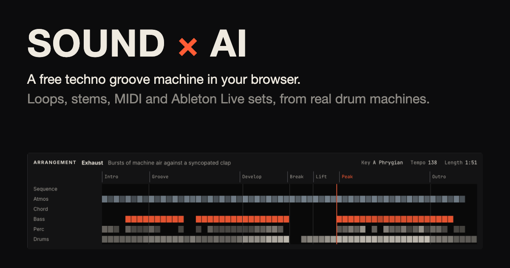

# Sound × AI


[](https://sound-x-ai.vercel.app)

**[▶ Open the live studio](https://sound-x-ai.vercel.app)**

A free techno groove machine that runs entirely in your browser. It writes dark, hypnotic,
percussion-led techno and plays it through recordings of real drum machines, metal, pianos
and rooms. Then you take it into your DAW: the loop, the stems, the MIDI, or a whole Ableton
Live set. There's no backend, no API key and no account.

**How it's made, in short:** Groove, the main style, is written by rules drawn from measuring
twelve reference records. In the other seven styles, the sequence line comes from a GRU I trained from scratch in NumPy,
with hand-written back-propagation and Adam, on 9,248 riffs from real MIDI (13,502 in all,
split by artist). On artists it never saw, it scores 1.24 nats against 1.56 for the n-gram
baseline. The forward pass is re-implemented in TypeScript and checked against Python by a
test. A custom Web Audio engine plays everything through real recordings and two measured
rooms, with the same signal path for live playback and export. The mix is matched to
commercial records by measurement.

## Make a track

- Press play. Groove opens on eight bars at the peak. Full track plays the whole arrangement,
  up to 208 bars (about six minutes, a club length).
- Pick a style, or press Randomise for a new Groove family with its settings varied within that family's limits.
- Change energy, light, density, key and tempo as it plays, without stopping it.
- See every layer enter and leave on one screen, and click any bar to play from there.
- Mute, solo, re-roll or lock each part. With a part locked, New take and Randomise rewrite only the others.
- Set each part's level. Levels travel in share links.
- Swap any drum sound for another recording, or drop in your own. Your own files stay in this
  browser and out of share links, and your own kick is measured so it's tuned to the key.
- Click the piano roll to add or remove a note everywhere that pattern repeats. Shift-click changes one bar.
- Undo, redo, and go back to any of your last 30 takes, which survive a reload.
- Drop in an audio file to set the tempo, key, energy and light from it. Nothing leaves your device.
- Outside Groove, watch the model's note probabilities, then hold a note and it rewrites what follows.
- Turn on Taste and Randomise learns which families and settings you keep and skip (see [Learning your taste](#learning-your-taste)).

Keys: **Space** play and stop, **G** new take, **R** randomise, **L** cycle the loop,
**⌘/Ctrl Z** undo, **⇧⌘/Ctrl Z** redo.

## Take it into your DAW

| | The loop (4, 8 or 16 bars, or a section) | The whole track |
|---|---|---|
| **Mix** | WAV or AIFF that repeats without a click | WAV or AIFF |
| **Stems** | Zip of WAVs | Zip of WAVs |
| **MIDI** | One file, a track per part | One file, a track per part |
| **Ableton Live 12 set** | | Zip: stems, MIDI and section markers in one project |
| **DJ tools** (Groove) | | Zip: the peak's drums as a 16-bar loop, the same without the kick, the build into the first drop, and the drums as MIDI |
| **Drag out** (Chrome, Edge) | MIDI or WAV, straight from the Export menu into your DAW | |

- **Formats:** 24 or 16-bit (16-bit is dithered), at 48 or 44.1 kHz. Parts you muted are left out.
- **Tags:** tempo, key, Camelot number and the Beatport shelf as the genre, so Rekordbox, Traktor and Serato read them.
- **Stems** are the kick on its own, clap and snare, hats and cymbals, percussion, the low
  end, the music and the effects, all the same length from bar 1. They keep the master's
  tone but not its compression or ceiling, so together they rebuild the mix.
- **The Ableton set** unzips to a project folder. Open the `.als` in Live 12 (Intro and up):
  the stems play on audio tracks, warped so they follow the set's tempo, every part sits on
  a MIDI track ready for your own instruments, and each section has a locator. Live 11 and
  earlier can't open Live 12 sets.
- **DJ version** (Groove): about eight minutes, with 32 bars of drums alone at each end (kick
  and hats first) and the rumble held back there, so it mixes in and out.
- **Web MIDI out** (Chrome, Edge, Firefox): play the track on your own instruments, with
  clock, start, stop and song position so a DAW follows.
- **Share link:** reopens the exact track, settings and edits included.

## Styles

| Style | Shelf | Character |
|---|---|---|
| **Groove** | Peak Time / Driving | Twelve families, each built on one idea |
| **Hypnotic** | Raw / Deep / Hypnotic | Turning loops, long echoes |
| **Percussive** | Peak Time / Driving | Tuned toms, taps and hand claps |
| **Raw** | Raw / Deep / Hypnotic | Anvil, brake drum, rumble |
| **Dub** | Raw / Deep / Hypnotic | One chord, tape and space |
| **Acid** | Peak Time / Driving | Accent, slide, resonance |
| **Hard** | Hard Techno | A driven kick and a distorted rumble, from 156 BPM |
| **Bounce** | Hard Techno | Offbeat bass, piano chords and a hook up front, from 152 BPM in D# minor |

## How Groove is built

Each of the twelve families has one lead idea: a stab, a rolling low end, a percussion hook,
a chopped texture, a squared 808 line or a sequence. It also has its own kit, tempo and key
range, clap or snare role, and rules for what the other parts leave out.

- **The idea is there from the first bar** and the other parts leave it room.
- **A track has a beginning, a middle and an end.** It states the idea bare and filtered, then
  opens up and answers it. The first drop changes to the family's other sounds, with another
  answer and a bigger backbeat, and the outro goes back to how it began. The idea's first bar holds throughout.
- **The flow is wind-down and return.** The low end leaves for a beat, a bar or two bars at
  phrase ends, and for one main break. It comes back at full level exactly on the one.
- **The clap has a job.** It can be the backbeat, the answer or the tension into a hit, and
  each family has its own snare, layered from the recordings.
- **Weak combinations are turned down:** no clear idea, parts on top of it, too empty or too busy.

The rules came from measuring the structure of twelve reference records. No pattern or audio
from them is used.

## How every style works

- **Everything is on the grid.** Two club records measured within 2 ms of it, with no swing,
  so every voice plays dead on its step with only a hair of drift. The one push is a bright
  layer of the backbeat, 24 ms late.
- **Loops turn against the bar.** Percussion loops over 3, 5, 6, 7, 12 or more
  steps, so a short pattern takes several bars to repeat.
- **Arrangement is addition and subtraction.** Layers enter and leave through the track, with
  small changes every 4 bars, and the sub leaves for a bar or two at the end of each 16-bar phrase.
- **The low end is drums.** Outside Acid and Bounce the bass never leaves the tonic, and its
  groove is in the gaps and the weight. Bounce's bass plays the offbeat, and its kick is tuned
  to sit between 65 and 92 Hz in every key.
- **The harmony stays in key.** A test checks every pitched lane in every style and key.
- **Repeats vary.** The kick stays steady. Hats, percussion, bass and synths shift in tuning,
  timing or brightness, and the variation is seeded, so an export matches what you heard.

## Sound quality

The mix is measured, not guessed: the same meters run on reference records and on our
renders, and the balance is matched within a couple of dB in every band up to 22 kHz.

| | Groove | Hard | Bounce |
|---|---|---|---|
| Loudness | about -8 LUFS | about -5 LUFS | about -7 LUFS |
| True peak | -1 dBTP | -1 dBTP | -1 dBTP |
| Stereo correlation | 0.98 | 0.83 to 0.89 | 0.96 |

- **The top octave is there.** The browser's own low-pass filter cuts far too much near the
  top of the band, and every hit is filtered by its velocity, so the hats lost their air.
  Each hit now uses a filter that follows the analog curve all the way up
  ([`master.ts`](src/lib/audio/master.ts)), with a gentle lift above 16 kHz.
- **No overs.** Full mixes and loops end in a look-ahead true-peak limiter that holds them under
  -1 dBTP, so they don't distort on a converter or in an MP3. A loop is limited as a loop, so
  the gain at its end already leads into its start.
- **Mono-safe.** The low end is mono, and Hard's distortion is folded to mono before it is
  widened, so it survives a mono club system.
- **Both sample rates are native.** At 44.1 kHz the recordings are decoded at 44.1 kHz rather than converted after the fact.

## Sounds

| Layer | Source |
|---|---|
| **Drums** | Original TR-808 recordings, Roland TR-8 hardware, hand claps, layered |
| **Percussion** | 808 toms tuned to the key, rims, shaker, a real anvil and brake drum |
| **Bass** | The tail of an original TR-808 kick for the sub, with a short filtered drum or impact for the knock |
| **Chords** | A recorded Steinway B grand by default; an upright piano, a pipe organ or a vibraphone instead |
| **Atmosphere** | A struck gong an octave down |
| **Sequence** | Yamaha TX81Z hardware through a fast filter |
| **Space** | Convolution reverb measured in Oxford's medieval Divinity School and York Guildhall |
| **Rumble** | A long 808 kick through that hall, driven, filtered to the sub and ducked on every hit |
| **Echo** | A dub tape delay at a dotted eighth, with filtered, saturated repeats and wow |
| **Texture** | Vinyl noise, and risers made from a scraped gong and a cymbal played backwards |

The kick is tuned to the key and width folds down to mono. Each style has its own kit. Every
recording is CC0, and the two reverb rooms are CC BY 4.0: see [SOURCES.md](public/samples/SOURCES.md).

## Using what you make

Sound × AI claims no rights in what you export. Many stores and distributors now refuse
tracks made wholly by generators, so treat an export as a starting point: change it, add
your own parts, make it yours before you release it. This isn't legal advice. The
recordings' licences are in [SOURCES.md](public/samples/SOURCES.md).

## The model

| Model | NLL on unseen artists (nats, lower is better) |
|---|---|
| Random guess | 3.18 |
| Bigram | 1.70 |
| Trigram | 1.55 |
| 4-gram (the baseline, best on validation) | 1.56 |
| **GRU** | **1.24** |

The baseline is picked on validation, like everything else. The trigram scores slightly lower
on test, but choosing it for that reason would mean tuning on the test set.

The first version (commit `14c88ae`) trained on exactly 20 hand-written motifs and had no
held-out data, so there was no way to tell learning from memorising. I rebuilt the pipeline:
real data from the Lakh MIDI Dataset, a split by artist (52 artists), early stopping and baselines. The
[model card](ml/MODEL_CARD.md) has the method and its limitations.

The corpus is 80s and 90s dance and pop, not dark groove, so the model is given a small
job: the sequence line outside Groove, and the 303 line in Acid. Everything else is written
by rules, in [`generative-engine.ts`](src/lib/generative-engine.ts) and [`groove/`](src/lib/groove).

## Learning your taste

Groove itself has no machine learning. Taste adds a small, honest piece of it: preference
learning from how you use the studio. It's off until you turn it on, and nothing leaves the browser.

- **What counts.** A Groove take is *kept* when you export it, change it, or play it for 45
  seconds, and *skipped* when you move on sooner. A take you barely heard counts for nothing.
- **The model** ([`taste.ts`](src/lib/taste.ts)): a Beta posterior over each family's keep rate,
  sampled by Thompson sampling to choose the family, plus the mean and spread of the settings
  you kept in it. One pick in five stays random, so it never closes in on itself.
- **The test.** It trains on your earlier takes and is scored on the latest 30%, which it
  never saw, against a baseline that predicts your overall keep rate (log loss and AUC).
  The panel shows the result once there are about 50 takes.

The [tests](src/lib/taste.test.ts) check it on simulated listeners. With nothing learned, it
picks every family evenly. It leans towards a simulated listener's favourites. It beats the
baseline on held-out takes. And it finds nothing in coin flips. It hasn't been measured on real people yet:
that needs real use, and a blind vote before and after.

## Audio analysis

[`audio-analysis.ts`](src/lib/audio-analysis.ts) is plain DSP with no ML library:

- **Tempo:** a low-weighted onset envelope scored with a comb filter at 1, 2, 4 and 8 beats, between envelope frames
- **Key:** peak-picked chroma from a long FFT, correlated with Krumhansl-Kessler key profiles
- **Energy and brightness:** RMS loudness and spectral centroid

The [tests](src/lib/audio-analysis.test.ts) check tempo to within 1 BPM on pulses from 120 to
145 BPM, and key on chord progressions in all 12 minor keys plus C major. Those are clean
signals. Real mixes are harder, especially dense, drum-heavy ones, so the app labels the key
an estimate and you can change it in one click.

## Privacy and analytics

Nothing you make leaves the browser. When `VITE_GOATCOUNTER` is set at build time (in
`.env.production`, to `https://<code>.goatcounter.com/count`), the page counts visits and
a handful of anonymous events with [GoatCounter](https://www.goatcounter.com/): no cookies, no
personal data. The events are `play`, `listened-30s`, `randomise`, `export-*`, `drag-*`,
`share`, `dj-version`, `midi-connect`, `taste-on`, `own-sample` and `return-*`. Without the
variable, nothing is loaded.

## Browsers

Any current browser plays and exports. Web MIDI out needs Chrome, Edge or Firefox, and dragging
files out of the Export menu needs Chrome or Edge. On a phone, the Export menu also offers a link to finish on a computer.

## Stack

Vite, React, TypeScript, the native Web Audio API and Canvas, deployed on Vercel.
`@tonejs/midi` writes MIDI files. The zip, WAV, AIFF, tag, gzip and Live set writers have no
dependencies. Training uses only NumPy. CI runs the tests and the build on every push to main and every pull request.

See [ARCHITECTURE.md](ARCHITECTURE.md) for the design and signal path.

## Run locally

```bash
npm install
npm run dev      # http://localhost:5173
npm test         # 279 tests
npm run build    # typecheck + production build
```

## Project structure

```
src/
├── App.tsx                   layout and keyboard shortcuts
├── hooks/useStudio.ts        all studio state and actions
├── hooks/useMidi.ts          MIDI ports and settings
├── components/
│   ├── Overview.tsx          the whole arrangement on one screen
│   ├── TrackTimeline.tsx     pattern editor, mixer strips
│   ├── Spectrum.tsx          analyser on the master
│   ├── NeuralPanel.tsx       live view of the riff model
│   ├── Controls.tsx          style, sliders, length, key
│   ├── Transport.tsx         play, position, loop, export, MIDI menu
│   ├── Sounds.tsx            swap drum sounds, add your own
│   ├── TastePanel.tsx        opt-in taste learning and its held-out score
│   ├── MidiPanel.tsx         Web MIDI output and clock
│   └── AudioDropzone, Credits
└── lib/
    ├── generative-engine.ts  writes the track: styles, arrangement, mix
    ├── groove/               Groove's families, part choice, flow, composer and DJ version
    ├── writing.ts            randomness and note helpers both composers share
    ├── labels.ts             names, shelves and colours the interface shows
    ├── history.ts            undo, redo, takes
    ├── neural-engine.ts      GRU forward pass and sampling
    ├── audio-analysis.ts     tempo and key detection
    ├── share.ts              permalinks
    ├── taste.ts              preference learning from keeps and skips
    ├── analytics.ts          anonymous counts (GoatCounter), off unless configured
    ├── midi.ts               MIDI messages, clock and song position
    ├── zip.ts                zip writer, no dependency
    ├── ableton.ts            Ableton Live 12 set (.als) writer
    └── audio/
        ├── samples.ts        loads and decodes the recordings, per sample rate
        ├── kits.ts           each style's sounds, and the swaps
        ├── own-samples.ts    your own sounds, kept in this browser
        ├── graph.ts          channel strips, sends, rumble, master chain
        ├── voices.ts         plays each note through its recording
        ├── player.ts         live playback and the transport
        ├── render.ts         offline export: mix, loops, stems, Live set, DJ tools, MIDI
        ├── master.ts         true-peak limiter and the matched low-pass
        ├── slice.ts          loop slices and stems
        └── tags.ts           WAV and AIFF tags, Camelot
ml/                           corpus builder, trainer, results, model card
scripts/build_samples.py      builds the sample pack
public/samples/               the recordings and their credits
```

## Licence

The code is [MIT](LICENSE). The recordings keep their own licences, listed in
[SOURCES.md](public/samples/SOURCES.md).

---

Built by [Tangeni Idhenga](https://www.tangeniidhenga.com).
